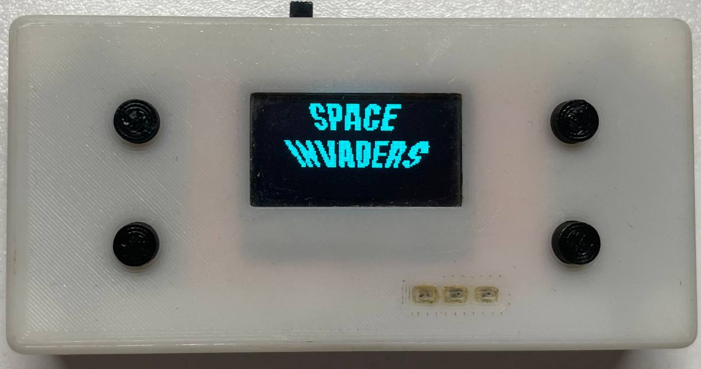
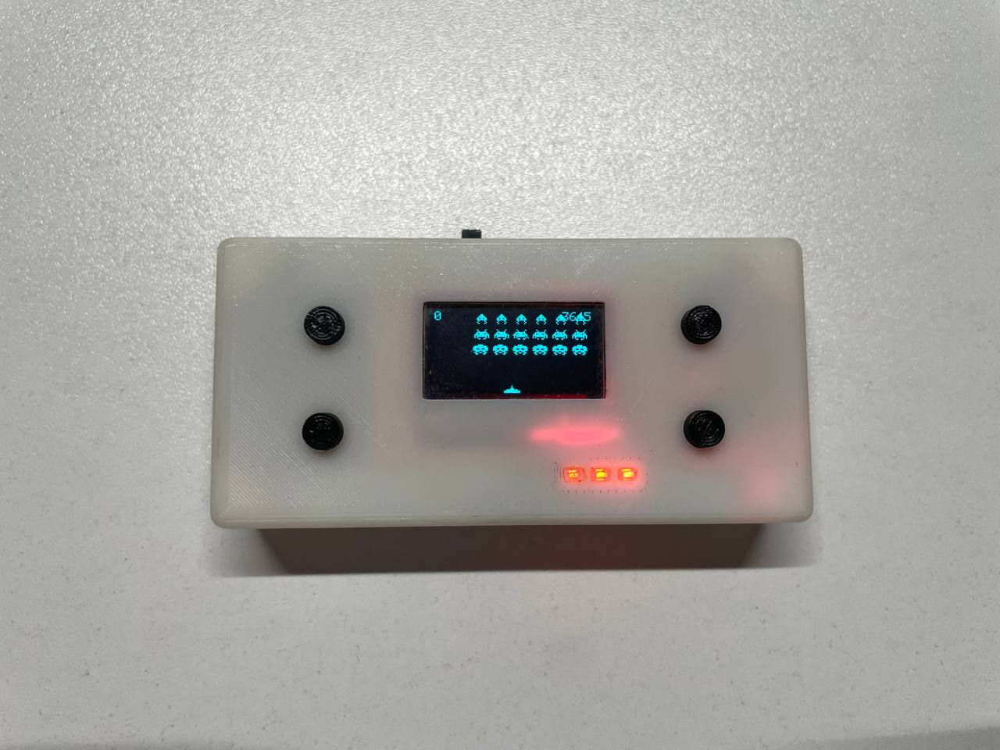
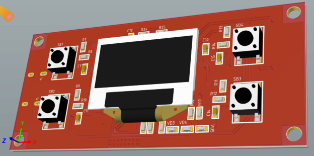
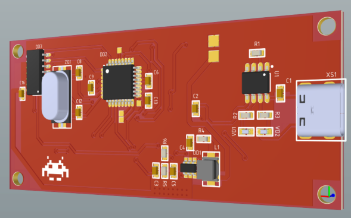

# Mini Game Console — Space Invaders

A custom-designed and fully assembled mini game console inspired by the classic arcade game Space Invaders.

The project was developed from scratch, including circuit design, PCB layout, embedded firmware, and a custom 3D-printed enclosure.

## Overview

## Features

- ATmega328P microcontroller
- SSD1306 OLED display
- Custom-designed electronic schematic
- Custom PCB designed in Altium Designer
- Embedded firmware developed with PlatformIO
- Custom enclosure designed in Autodesk Fusion
- 3D-printed enclosure
- Fully assembled hardware

## Hardware Design

The electronic circuit and PCB were designed from scratch in Altium Designer.

## Enclosure Design

The enclosure was designed from scratch in Autodesk Fusion and manufactured using 3D printing.

## Firmware

The firmware is developed using PlatformIO.

### Building the Project

1. Install [Visual Studio Code](https://code.visualstudio.com/).
2. Install the [PlatformIO IDE extension](https://platformio.org/).
3. Clone this repository.
4. Open the firmware project in VS Code.
5. Build the firmware using PlatformIO.

See `platformio.ini` for the project configuration.

## Project Status

**Completed**

Circuit design, PCB development, firmware, enclosure design, 3D printing, and hardware assembly are complete.